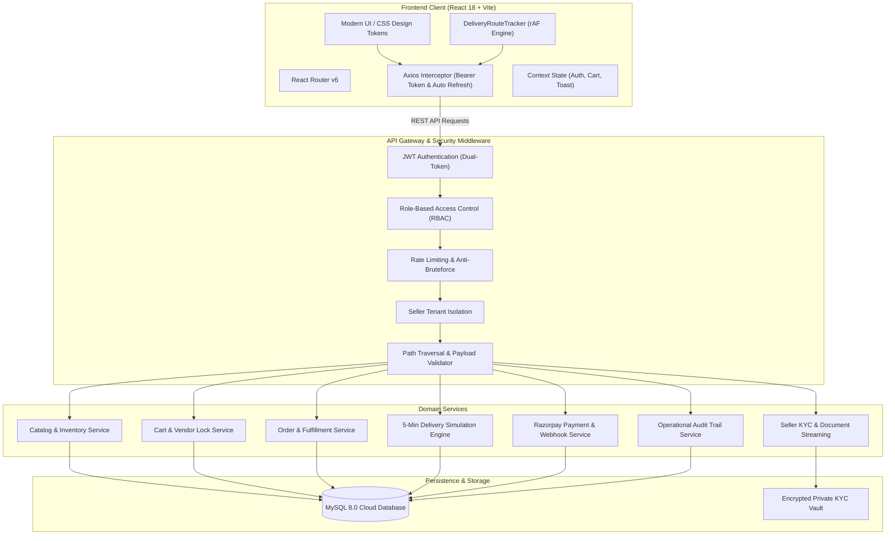
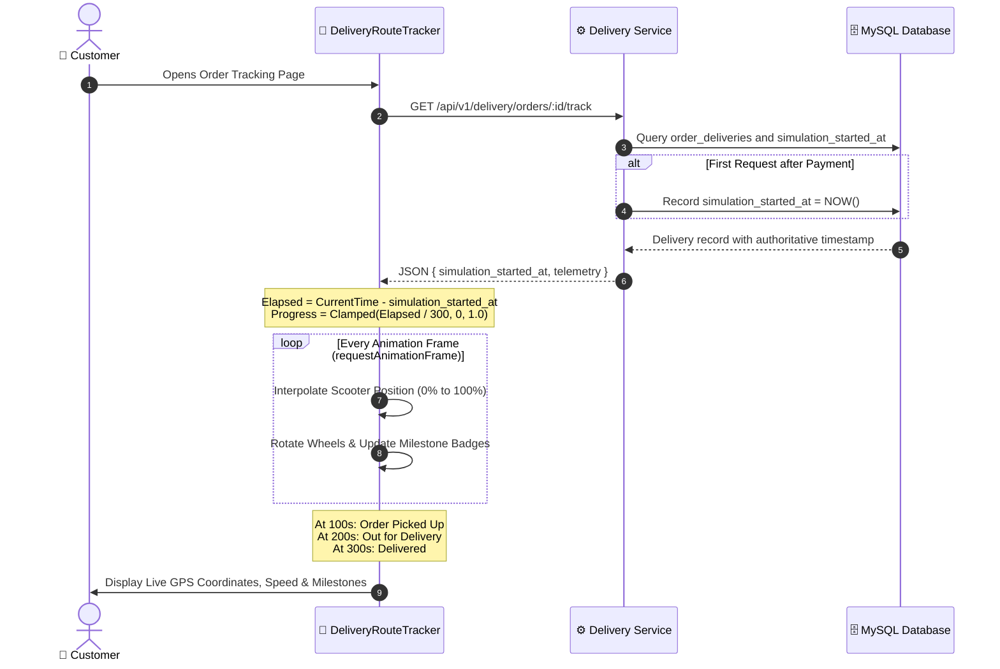
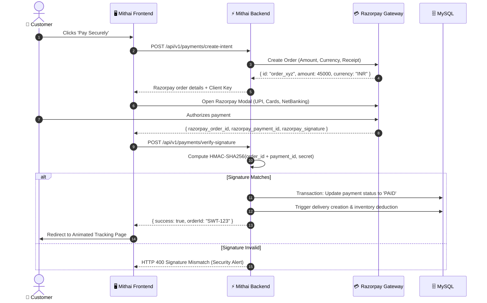

# <p align="center">🪔 Mithai Mahal (मिठाई महल) 🪔</p>

<p align="center">
  <strong>The Digital Renaissance of Artisanal Indian Confectionery</strong>
</p>

<p align="center">
  <em>An enterprise-grade, multi-vendor Mithai e-commerce ecosystem featuring real-time Razorpay checkout, live 5-minute simulated delivery tracking with GPS telemetry, automated KYC vendor compliance, and multi-role operations governance.</em>
</p>

<p align="center">
  
  
  
  
  
  
  
  
</p>

---

## 📑 Table of Contents

- [✨ Platform Highlights](#-platform-highlights)
- [🏛️ System Architecture](#️-system-architecture)
- [🛵 5-Minute Live Animated Delivery Journey](#-5-minute-live-animated-delivery-journey)
- [💳 Razorpay Payment & Settlement Engine](#-razorpay-payment--settlement-engine)
- [🛡️ Role-Based Access Control (RBAC)](#️-role-based-access-control-rbac)
- [🏪 Seller Portal & Compliance (KYC)](#-seller-portal--compliance-kyc)
- [📊 Executive Analytics & Operations Governance](#-executive-analytics--operations-governance)
- [🗺️ Interactive User Portals & Routes](#️-interactive-user-portals--routes)
- [📡 RESTful API Specifications](#-restful-api-specifications)
- [💾 Database Architecture & Data Dictionary](#-database-architecture--data-dictionary)
- [🚀 Quick Start & Installation](#-quick-start--installation)
- [🧪 Test Automation & Quality Assurance](#-test-automation--quality-assurance)
- [🔒 Enterprise Security Principles](#-enterprise-security-principles)
- [📄 License & Credits](#-license--credits)

---

## ✨ Platform Highlights

- 🪔 **Authentic Regional Heritage**: Discovery catalog curated by traditional categories — *Kaju Katli, Bengali Rasgulla, Pure Desi Ghee Mysore Pak, Crispy Jalebi, Motichoor Laddu, and Royal Dry Fruit Halwa*.
- 🛍️ **Single-Vendor Cart Enforcement**: Smart multi-vendor protection with transactional cart conflict detection and graceful shop-switching modals.
- 🛵 **Deterministic 5-Minute Delivery Simulation**: Authoritative server-persisted delivery timeline running a 300-second journey across 4 dynamic milestones with simulated vehicle GPS telemetry.
- 💳 **Integrated Razorpay Payments**: Production-grade payment intent handling, modal checkout, cryptographic SHA-256 HMAC signature verification, and automated refunds.
- 📁 **Secure KYC Document Processing**: Private disk storage and authenticated streaming pipeline supporting inline PDF inspection and high-resolution certificate rendering with zero public exposure.
- 📊 **Real-Time Analytics Visualizer**: SVG-powered sales and order trajectory visualization across 7, 14, and 30-day horizons with dynamic tooltips and metric cards.
- 🛡️ **6-Tier Role-Based Access Control**: Strict permissions guarding Super Admins, Operations Admins, Accountants, Support Agents, Vendors, and Customers.

---

## 🏛️ System Architecture

Mithai Mahal is architected as a modular, decoupled full-stack application following clean architectural separation of concerns:



---

## 🛵 5-Minute Live Animated Delivery Journey

The delivery tracker replaces typical static order statuses with an **authoritative, real-time simulated delivery journey**:



### Key Engineering Features:
- **Zero Drift on Refresh**: The start timestamp is saved on the server in `order_deliveries.simulation_started_at`. Refreshing the browser or opening multiple tabs calculates identical elapsed progress.
- **Micro-Milestone Timing**:
  - `0s - 100s`: **Rider Assigned** (Preparing dispatch)
  - `100s - 200s`: **Order Picked Up** (En route from sweet shop)
  - `200s - 300s`: **Out for Delivery** (Final transit leg)
  - `300s`: **Delivered** (Order completed with success state)
- **High-Performance Canvas/SVG**: Utilizes CSS GPU acceleration (`transform: translate3d`) driven by `requestAnimationFrame`, consuming minimal CPU.
- **Accessibility**: Native `prefers-reduced-motion` compliance switches the view to a calm, stepped progression for sensitive users.

---

## 💳 Razorpay Payment & Settlement Engine



---

## 🛡️ Role-Based Access Control (RBAC)

The platform enforces strict enterprise RBAC across 6 discrete user archetypes:

| Role | Scope & Permissions | Key Capabilities |
|---|---|---|
| **`SUPER_ADMIN`** | Platform-Wide Master | Full system access, vendor approvals, platform metrics, financial audits. |
| **`ADMIN`** | Operations Governance | Reviews vendor KYC, inspects licenses, resolves tickets, monitors orders. |
| **`ACCOUNTANT`** | Financial Oversight | Vendor settlement records, invoice audits, revenue disbursement logs. |
| **`CUSTOMER_CARE`** | Support & Dispatch | Ticket handling, customer order status adjustments, delivery dispute resolution. |
| **`SELLER`** | Vendor Tenant | Shop catalog management, inventory adjustments, orders fulfillment, KYC submission. |
| **`CUSTOMER`** | Consumer | Catalog discovery, cart creation, address book, checkout, live delivery tracking. |

---

## 🏪 Seller Portal & Compliance (KYC)

To guarantee food safety and regulatory compliance across India, every sweet artisan undergoes an onboarding verification process:

```
[Vendor Registration] ──> [Upload GSTIN & FSSAI] ──> [Encrypted Storage]
                                                            │
                                                            ▼
[Vendor Storefront Active] <── [Admin Approval] <── [Admin Document Audit]
                                                            │ (If invalid)
                                                            ▼
                                                [Document Rejection + Reason]
```

1. **Vendor Application**: Onboarding captures shop legal entity, GSTIN (15-character formatted), and 14-digit FSSAI license number.
2. **Encrypted Private Storage**: Compliance documents are saved outside the public root in `private_uploads/seller_documents/` with randomized UUID filenames.
3. **Admin Verification Panel**:
   - Explicit badges: `AVAILABLE (KB)` vs `FILE MISSING / PLACEHOLDER`.
   - Approval Gating: Prevents approving any vendor whose documents are missing, placeholder, or rejected.
   - Live Preview Modal: Authenticated streaming (`GET /api/v1/sellers/:id/documents/:docId/file`) serves inline PDFs and high-resolution images with JWT authentication headers.
4. **Audit Logging**: Every administrative action records the timestamp, actor ID, email, IP address, and review notes into `audit_logs`.

---

## 📊 Executive Analytics & Operations Governance

The Super Admin Dashboard provides business intelligence without external charting dependencies:

- **Daily Sales & Order Trajectory**: Interactive SVG chart dynamically supporting **7-Day**, **14-Day**, and **30-Day** rolling aggregates.
- **Dual Axis Rendering**: Revenue bars coupled with order frequency markers.
- **Hover Micro-Interactions**: Real-time floating telemetry cards with formatted Indian Rupee (`₹`) values and exact transaction counts.
- **Operational Metrics**:
  - Total Platform Revenue & Daily Moving Average
  - Active Sweet Shops vs Pending KYC Applications
  - Live Transit Orders & Dispatch Velocity
  - Low-Stock Inventory Alerts below safety thresholds

---

## 🗺️ Interactive User Portals & Routes

### 🛒 Customer Experience
| Route | Component | Purpose |
|---|---|---|
| `/` | `HomePage` | Hero banner, artisanal sweet categories, featured shops, bestsellers |
| `/shops` | `ShopListPage` | Multi-shop marketplace directory with ratings and city filters |
| `/shops/:id` | `ShopDetailPage` | Dedicated vendor storefront and curated sweet catalog |
| `/cart` | `CartPage` | Single-vendor cart validator and item customization |
| `/checkout` | `CheckoutPage` | Saved address selection and order cost breakdown |
| `/orders` | `OrdersPage` | Customer order history with live status badges |
| `/orders/:id` | `OrderDetailPage` | Detailed item receipts, invoice summary, and vendor contact |
| `/orders/:id/track` | `TrackingPage` | **5-Minute Live Animated Delivery Journey & GPS Telemetry** |
| `/support` | `SupportPage` | Customer care ticket generation and resolution chat |

### 🏪 Vendor (Seller) Portal
| Route | Component | Purpose |
|---|---|---|
| `/seller/register` | `SellerRegisterPage` | Vendor onboarding and business registration form |
| `/seller/verification`| `SellerVerificationPage`| KYC document uploader for FSSAI licenses and GSTIN certificates |
| `/seller/dashboard` | `SellerDashboardPage` | Catalog management, stock adjustments, live kitchen orders |

### 🛡️ Administration & Governance
| Route | Component | Purpose |
|---|---|---|
| `/admin/dashboard` | `AdminDashboardPage` | Operations command center, KYC review queue, active dispatch |
| `/admin/sellers` | `AdminSellersPage` | Platform vendor directory, document audit, status toggles |
| `/super-admin/dashboard` | `SuperAdminDashboardPage`| Executive trajectory analytics, platform financial metrics |

---

## 📡 RESTful API Specifications

<details>
<summary><strong>🔐 Authentication & Identity (<code>/api/v1/auth</code>)</strong></summary>

| Method | Endpoint | Access | Description |
|---|---|---|---|
| `POST` | `/api/v1/auth/register` | Public | Register new customer or vendor user |
| `POST` | `/api/v1/auth/login` | Public | Authenticate user, receive Access & Refresh tokens |
| `POST` | `/api/v1/auth/refresh-token` | Public | Rotate expired access token using valid refresh token |
| `POST` | `/api/v1/auth/logout` | Authenticated | Revoke refresh token and invalidate session |
| `GET` | `/api/v1/auth/me` | Authenticated | Retrieve authenticated profile and role permissions |
</details>

<details>
<summary><strong>🛍️ Catalog & Sweet Shops (<code>/api/v1/catalog</code>, <code>/api/v1/shops</code>)</strong></summary>

| Method | Endpoint | Access | Description |
|---|---|---|---|
| `GET` | `/api/v1/catalog/categories` | Public | List all sweet categories with active items count |
| `GET` | `/api/v1/catalog/products` | Public | Search products by category, keyword, or vendor |
| `GET` | `/api/v1/shops` | Public | List verified and active sweet shops |
| `GET` | `/api/v1/shops/:id` | Public | Retrieve shop profile, address, and live inventory |
</details>

<details>
<summary><strong>🛒 Cart, Orders & Deliveries (<code>/api/v1/cart</code>, <code>/api/v1/orders</code>, <code>/api/v1/delivery</code>)</strong></summary>

| Method | Endpoint | Access | Description |
|---|---|---|---|
| `GET` | `/api/v1/cart` | Customer | Fetch current cart items with single-vendor validation |
| `POST` | `/api/v1/cart/items` | Customer | Add product to cart (triggers vendor conflict check) |
| `POST` | `/api/v1/orders` | Customer | Convert cart to confirmed order record |
| `GET` | `/api/v1/orders/:id` | Customer/Admin| Retrieve order details and items |
| `GET` | `/api/v1/delivery/orders/:id/track` | Customer/Admin| **Retrieve 5-minute delivery timeline & GPS telemetry** |
| `POST` | `/api/v1/delivery/orders/:id/refresh` | Customer/Admin| Trigger telemetry heartbeat update |
</details>

<details>
<summary><strong>💳 Payments & Checkout (<code>/api/v1/payments</code>)</strong></summary>

| Method | Endpoint | Access | Description |
|---|---|---|---|
| `POST` | `/api/v1/payments/create-intent`| Customer | Create Razorpay order intent with backend validation |
| `POST` | `/api/v1/payments/verify-signature`| Customer | Verify HMAC-SHA256 signature and complete order |
| `POST` | `/api/v1/payments/webhook` | Public (Signed)| Handle Razorpay asynchronous payment webhooks |
</details>

<details>
<summary><strong>📁 Seller Verification & KYC (<code>/api/v1/sellers</code>)</strong></summary>

| Method | Endpoint | Access | Description |
|---|---|---|---|
| `POST` | `/api/v1/sellers/register` | Public | Register new sweet shop legal entity |
| `POST` | `/api/v1/sellers/documents` | Seller | Upload compliance document (PDF, PNG, JPEG) |
| `GET` | `/api/v1/sellers/:id/documents`| Admin/Seller | List documents with verification flags |
| `GET` | `/api/v1/sellers/:id/documents/:docId/file` | Admin/Super | **Secure authenticated file stream for preview** |
| `POST` | `/api/v1/sellers/:id/review` | Admin/Super | Approve or reject vendor onboarding application |
</details>

---

## 💾 Database Architecture & Data Dictionary

The platform runs on a normalized **MySQL 8.0** schema with 31 interconnected tables enforcing referential integrity:

```
┌─────────────────────────────────┐       ┌─────────────────────────────────┐
│             users               │       │             sellers             │
├─────────────────────────────────┤       ├─────────────────────────────────┤
│ id (PK, UUID)                   │◄──────┤ id (PK, UUID)                   │
│ email (VARCHAR, UNIQUE)         │       │ user_id (FK -> users.id)        │
│ password_hash                   │       │ business_name, owner_name       │
│ role (ENUM)                     │       │ gstin (15 chars, UNIQUE)        │
│ is_active (BOOLEAN)             │       │ verification_status (ENUM)      │
└────────────────┬────────────────┘       └───────────────┬─────────────────┘
                 │                                        │
                 ▼                                        ▼
┌─────────────────────────────────┐       ┌─────────────────────────────────┐
│             orders              │       │        seller_documents         │
├─────────────────────────────────┤       ├─────────────────────────────────┤
│ id (PK, VARCHAR)                │       │ id (PK, UUID)                   │
│ customer_id (FK -> users.id)    │       │ seller_id (FK -> sellers.id)    │
│ seller_id (FK -> sellers.id)    │       │ document_type, file_path        │
│ total_amount, payment_status    │       │ verification_status, file_size  │
└────────────────┬────────────────┘       └─────────────────────────────────┘
                 │
                 ▼
┌─────────────────────────────────┐       ┌─────────────────────────────────┐
│        order_deliveries         │       │           audit_logs            │
├─────────────────────────────────┤       ├─────────────────────────────────┤
│ id (PK, UUID)                   │       │ id (PK, INT AUTO_INCREMENT)     │
│ order_id (FK -> orders.id)      │       │ actor_id, actor_role, action    │
│ delivery_status (ENUM)          │       │ target_entity, target_id        │
│ simulation_started_at (DATETIME)│       │ metadata (JSON), ip_address     │
│ current_latitude, longitude     │       │ created_at (TIMESTAMP)          │
└─────────────────────────────────┘       └─────────────────────────────────┘
```

---

## 🚀 Quick Start & Laptop Handover (MySQL Workbench)

### Prerequisites
- [Node.js](https://nodejs.org/) (v18.0.0 or higher)
- [MySQL Server & MySQL Workbench](https://dev.mysql.com/downloads/workbench/) (v8.0 or higher)
- Git

---

### Step 1: Clone Repository
```bash
git clone https://github.com/VLakshmiChandana/Mithai_Mahal.git
cd Mithai_Mahal
```

---

### Step 2: Import Database in MySQL Workbench (⚡ 1-Click Setup)
You do not need to run manual SQL migrations. A complete, standalone database dump with all 31 tables, foreign keys, and seed records is provided:

1. Open **MySQL Workbench** and connect to your local MySQL instance (port `3306`).
2. Go to **File → Open SQL Script...** (or press `Ctrl + Shift + O`).
3. Select the file:
   ```
   database/sweet_shop_delivery_workbench.sql
   ```
4. Click the **⚡ Execute** (lightning bolt) icon on the toolbar.
5. In the left **Schemas** pane, right-click and select **Refresh All** — the `sweet_shop_delivery` database is now fully populated!

---

### Step 3: Configure & Start Backend Service
```bash
cd backend
npm install

# Copy environment template
cp .env.example .env
```

Open `backend/.env` and update your MySQL Workbench password:
```env
PORT=5000
NODE_ENV=development

# Enter your local MySQL credentials
DB_HOST=localhost
DB_PORT=3306
DB_USER=root
DB_PASSWORD=your_mysql_workbench_password
DB_NAME=sweet_shop_delivery

# Pre-configured JWT Secrets & test Razorpay keys are already set in .env.example!
```

Start the backend:
```bash
npm run dev
```
> Backend runs at: `http://localhost:5000`

---

### Step 4: Start Frontend Client
In a new terminal window:
```bash
cd ../frontend
npm install
npm run dev
```
> Frontend runs at: `http://localhost:5173` *(Vite automatically proxies all `/api` requests to port `5000`)*

---

### 🔑 Demo Accounts for Local Testing

| Portal | Email | Password | Role / Access |
|---|---|---|---|
| **Super Admin Dashboard** | `superadmin@mithaimahal.com` | `SuperAdminPass123!` | Executive Analytics, System Overseer |
| **Operations Command Center**| `admin@gmail.com` | `AdminPassword123!` | KYC Document Audit, Approvals, Orders |
| **Customer Experience** | `test.customer@gmail.com` | `Password123!` | Sweets Discovery, Cart, Tracking |

*(You can also register a brand new Customer or Sweet Shop vendor directly on the website).*

---

## 🧪 Test Automation & Quality Assurance

Mithai Mahal includes comprehensive verification test suites across all key layers:

```bash
cd backend

# 1. Admin Approval & Document Access Verification Suite (Phase 25)
node scripts/test-phase25-admin-approval.js
# Verified: 31/31 Passed (RBAC, streaming PDF/image, 403 blocks, audit logs)

# 2. 5-Minute Delivery Simulation & Timing Suite (Phase 22)
node scripts/test-phase22-simulation.js
# Verified: Elapsed calculation, rAF clamping, persistent start timestamps

# 3. Comprehensive Administrative Audit Log Suite (Phase 18)
node scripts/test-phase18-audit.js
# Verified: 38/38 Passed (Actor audit trails, target references)

# 4. Razorpay Signature Verification & Payment Suite (Phase 17)
node scripts/test-phase17-admin-razorpay.js
# Verified: 51/51 Passed (HMAC signatures, intent generation)

# 5. Production Frontend Build Verification
cd ../frontend
npm run build
# Verified: 0 Errors, 1,689 modules transformed cleanly
```

---

## 🔒 Enterprise Security Principles

- 🔑 **Dual-Token JWT Security**: Short-lived access tokens (15m) paired with rotating refresh tokens (7d) stored securely in session storage.
- 🗃️ **Private Non-Public File Storage**: Vendor KYC files are saved completely outside public document roots to prevent unauthorized exposure.
- 🛡️ **Path Traversal Defenses**: Document streamers strictly sanitize filenames and normalize paths to prevent `../` directory traversal attacks.
- 🔏 **Cryptographic Payment Integrity**: All Razorpay payment captures require SHA-256 HMAC signature validation before triggering order status transitions.
- 📝 **Immutable Audit Trail**: Administrative reviews, status overrides, and KYC actions write directly to an append-only `audit_logs` database.

---

## 📄 License & Credits

Distributed under the **MIT License**. See `LICENSE` for details.

Developed with ❤️ for the celebration of traditional Indian sweets and culinary craftsmanship.  
**Mithai Mahal Team** • 2026
